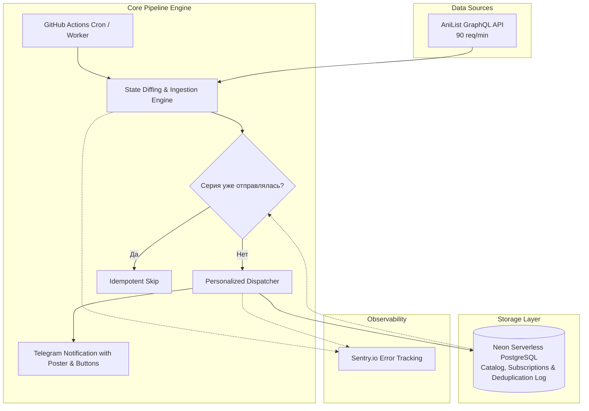

# Anime Radar — Scheduled Release Pipeline & Telegram Bot

[](https://python.org)
[](https://neon.tech)
[](https://telegram.org)
[](https://sentry.io)
[](LICENSE)

Пайплайн по расписанию (GitHub Actions, каждый час) и Telegram-бот на вебхуках для персонального отслеживания выхода новых серий аниме: подписки на тайтлы, рейтинги, таймеры релизов и дедупликация уведомлений на уровне БД.

---

## Архитектура системы



---

## Ключевые возможности

1. **GraphQL Ingestion:** Выгрузка комплексных структур данных (метаданные, таймстемпы, HD-постеры `extraLarge`, студии, жанры и оценки) за единый сетевой запрос.
2. **Строгие контракты данных (Data Contracts):** Полная типизация и валидация входящих данных на базе **Pydantic v2**.
3. **Идемпотентность и защита от дублей:** Контроль уникальности серий на уровне СУБД (`CONSTRAINT unique_anime_episode UNIQUE (anime_id, episode_number)`).
4. **Data Retention Policy:** Автоматическая самоочистка устаревших записей серий старше 90 дней (база никогда не переполняется).
5. **Интерактивный Telegram-бот (`aiogram`):**
   * Быстрый поиск аниме по тексту или команде `/track`.
   * Персональный список подписок (`/list`) с inline-кнопками удаления и статусами (`Онгоинг` / `Завершено`).
   * Ручная проверка релизов прямо из меню бота.
6. **Smart Retention & «Радар эфира» (Live Airing Match):**
   * Автоматический подбор свежих серий по любимым жанрам для пользователей, у которых все тайтлы в коллекции завершены.
   * Доставка без звука (`disable_notification=True`) и строгая воронка TOP-1 с кулдауном 24 часа.
   * Интерактивная кнопка «Добавить в отслеживание» в 1 клик.
7. **Интерактивный рекомендательный движок («Что посмотреть?»):**
   * Персональные рекомендации лучших онгоингов сезона на основе коллекции пользователя или мирового рейтинга AniList.
8. **Production Observability:** Централизованный сбор ошибок, аномалий и контекста через **Sentry** с защитой от утечек PII.

---

## Стек технологий

* **Язык:** Python 3.12+ / 3.14
* **Сетевой клиент:** `httpx` (async)
* **Telegram Framework:** `aiogram 3.x`
* **Валидация:** `pydantic v2`
* **База данных:** `asyncpg` + Neon PostgreSQL (Serverless Scale-to-Zero)
* **Observability:** `sentry-sdk`
* **CI/CD & Оркестрация:** GitHub Actions (Cron каждый час)
* **Cloud Webhook Hosting:** Vercel Serverless (24/7 Webhook Engine)

---

## Локальный запуск

1. **Клонируйте репозиторий:**
   ```bash
   git clone https://github.com/K0ldan/anime-radar-test.git
   cd anime-radar-test
   ```

2. **Создайте и активируйте виртуальное окружение:**
   ```bash
   python -m venv venv
   # Windows:
   .\venv\Scripts\activate
   # Linux/macOS:
   source venv/bin/activate
   ```

3. **Установите зависимости:**
   ```bash
   pip install -r requirements.txt
   ```

4. **Настройте переменные окружения:**
   Скопируйте пример конфига:
   ```bash
   cp .env.example .env
   ```
   Заполните ваши ключи в `.env`:
   ```env
   TELEGRAM_BOT_TOKEN=...
   TELEGRAM_CHAT_ID=...
   NEON_DATABASE_URL=postgresql://...
   SENTRY_DSN=https://...
   ```

5. **Запустите пайплайн проверки:**
   ```bash
   python main.py
   ```

6. **Запустите интерактивного бота:**
   ```bash
   python -m src.bot
   ```

---

## Лицензия

Проект распространяется под открытой лицензией [MIT](LICENSE).
